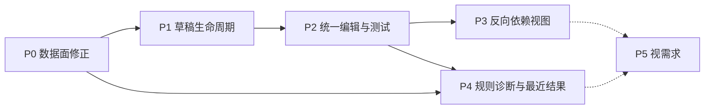

# 模型中枢（Model Hub）路由可靠性与编排改造计划

> 版本：v2.3，2026-11-06。状态：本轮 P0–P4 与 R1–R9 修复的代码和回归文件已接入，整体代码 review 已完成；本机编译、类型和静态检查见第 13 节。CI 执行与浏览器人工验收仍待完成；用户已授权按功能提交及推送，执行状态以 Git 记录为准，未发布。
>
> v2 依据对 v1（1168 行，M00–M15）的评审改写：先修数据面切换语义，再做编辑体验；流向图改为 Share 反向依赖视图；运行观测与诊断大幅缩减。v2.1 保留上述方向，补齐复审发现的并发、容量、兼容性和验收边界；修订记录见[第 9 节](#9-修订记录)。
>
> 代码基线：`0c9c057`。所有“现状”描述都已对照该提交的代码核实；文中“拟新增”的内容在实施前都不存在。

阅读顺序：第 1–4 节是产品决策与路线，写给所有参与者；第 5 节是 P0 的完整工程规格，可以直接执行；第 6–7 节是 P1–P5 的规格，P4、P5 只到概要级，开工前再补全；第 8 节是验证与发布规则。

## 1. 目标与范围

用户配置候选目标，是为了首选 Share 不可用时请求还能继续。这一轮要做到四件事：

1. **切换真正可靠。** 首选失效、上游 500、探测被中断这些常见情况下，请求按用户配置的顺序落到可用目标上。
2. **配置不丢、不误改。** 切换标签不丢草稿；任何读取、刷新或展示变化都不会自动写入路由。
3. **影响面看得见。** 某个 Share 出问题时，用户能直接看到哪些规则引用它、哪些规则没有已确认具备资格且在线的后续候选；不把配置分析当成真实切换结果。
4. **测试结果讲实话。** 测试和诊断标明自己验证了什么、没验证什么。

范围只限 Router，包括 `src/` 下的数据面与控制面，以及 `frontend/`。以下内容都不涉及：cc-switch-server、业务库及 metrics 库的 schema、Share Market、钱包、计费政策、跨 Router 调度。P4-4 仅为后续可选项，不授权本轮增加通知迁移。

## 2. 现状基线

### 2.1 已核实的实现

| 项目 | 现状 | 位置 |
|---|---|---|
| 配置读写 | `GET/PUT /v1/me/model-routing`，PUT 体为 `{ expectedRevision, routes }`，Immediate 事务整组替换，版本冲突返回 409 | `src/api.rs:3462-3497`、`src/store.rs:7824` |
| 容量 | 最多 100 条规则；每条 1 个首选加最多 5 个备选；模型名 trim 后 1–200 字符，大小写敏感；每个协议最多一条 `*` | `src/store.rs:28930-29055` |
| 选路 | 精确匹配优先于 `*`；精确规则失败后不会落到 `*` | `src/store.rs:8072-8113` |
| 首选失效 | 首选被删除、撤权或 App 关闭时，在选路阶段直接报错（503/403/409），备选不会被尝试 | `src/store.rs:8149-8175` |
| 备选失效 | 由 `load_route_candidates` 静默过滤 | `src/store.rs:29490` |
| 转发循环 | 每次请求最多实际转发 4 次；熔断跳过和离线不占次数；离线会记一次熔断失败 | `src/proxy.rs:2645-2711` |
| 切换状态码 | 401/403/429/502/503/504；**500 不切换** | `src/proxy.rs:2747` |
| 锁定时机 | 收到状态码就锁定；流式 200 中途出错不会切换，熔断器记一次成功 | `src/proxy.rs:2776-2790` |
| 熔断计数 | 不可切换的失败（例如 400）也计入熔断 | `src/proxy.rs:2785` |
| 模型禁用 | 统一入口在循环前只检查首选；底层 `proxy_handler` 仍对每个真实 Share 检查。缺口是候选循环没有提前跳过，不是备选绕过安全检查 | `src/proxy.rs:2640-2645,3852-3886` |
| 熔断器 | 键是路由 ID 加目标 Share，不同用户互不影响；连续 3 次失败打开，冷却 60 秒，Retry-After 上限 600 秒；纯内存；表只增不减；`acquire` 对每个新键都会插入 | `src/route_breaker.rs` |
| 半开探测 | 探测许可只在 `record_success/record_failure` 时释放，**没有 guard，也没有 Drop 处理** | `src/route_breaker.rs:89-118`、`src/proxy.rs:2671-2790` |
| 测试接口 | `/test` 只测首选，不走备选和熔断；Claude 设了 `max_tokens: 32`，**Codex 和 Gemini 没有设输出上限**；用户 Key 走正常计量 | `src/proxy.rs:3023-3117` |
| 切换信号 | `route_failover` 告警类型已注册但从未发出；`model_route_failover_total` 只递增，从未导出 | `src/notification_kinds.rs:200`、`src/metrics/mod.rs:103,489` |
| 指标采样 | 默认每 5 秒采样；`router_metrics` 为固定列结构，没有切换计数字段。相邻快照差值不等于 10 分钟累计 | `src/config.rs:1158-1160`、`src/metrics/store.rs:436-470` |
| 前端会话 | `ModelRoutingSession` 用 epoch/sequence 隔离迟到的回包，脏草稿时后台刷新不覆盖路由；收到 401/403 清空 | `frontend/lib/model-routing-session.ts` |
| 草稿丢失 | session 的 `useMemo` 依赖了 `[active, viewerKey]`，离开“我的”标签就触发 `stop()`，草稿被静默丢弃 | `model-hub-panel.tsx:121-144`、`client-board.tsx:670` |
| 间接切换 | `issuesOnly` 的 effect 会间接把标签切到“全部” | `client-board.tsx:723` |
| 已有交互 | 默认出口用穿梭框，精确规则有备选列表，两者都能用 @dnd-kit 拖拽排序；没有撤销/重做，没有图形库 | `model-hub-share-picker.tsx`、`model-hub-candidates.tsx` |

### 2.2 文档与代码不一致（P0-9 修正）

| 文档 | 写法 | 实际 |
|---|---|---|
| `PROTOCOL.md:624` | 401/403/429/**5xx** 可切换；“任何响应字节已发给客户端”才锁定 | 500 不切换；收到状态码时就锁定 |
| `PROTOCOL.md:626` | 被权限过滤的目标不占次数，队首被跳过后仍可尝试后续目标 | 只有备选如此；首选权限失效时直接报错 |
| `ARCHITECTURE.md:92` | 统一入口“不在失败时 fallback / 重试其他 Share” | 已实现候选切换 |
| `src/store.rs` 约 8250 行的注释 | 模型列表透传会切换候选 | 只转发首选（`src/proxy.rs:2536`） |

## 3. 已确认的决策

| 编号 | 决策 | 理由 |
|---|---|---|
| D1 | 数据面语义修正纳入本轮，作为 P0 先做 | 首选失效备选全部作废、500 不切换、探测许可泄漏，这些直接削弱了切换功能本身，比任何界面都更影响用户 |
| D2 | 流向图改为 Share 反向依赖视图 | 规则内的尝试顺序已经由列表表达；反向视图回答的是列表给不出的问题：这个 Share 出问题会影响哪些规则 |
| D3 | 草稿生命周期跟随账号，不跟随标签 | session 的创建依赖和读写有效性要一起调整；暂停读取不取消保存，凭据明文仍随隐藏清除，无需给标签切换增加确认弹窗 |
| D4 | 撤销/重做改为待保存修改清单，单项还原必须原子化 | 规则草稿最多 100 条，差异清单更好理解；失败时不产生半条规则或部分还原 |
| D5 | 不设“极简/完整”模式 | 用空状态操作和空区块折叠实现渐进展示，少一个状态维度 |
| D6 | 诊断改为 `/test` 的同步 `saved_route` 模式，加用户限流 | 最多 4 次转发，受输出上限和整次 deadline 约束；网络失败不自动重放，不引入异步去重或进程粘性。输出上限不是总 token 或费用上限 |
| D7 | 运行观测从已有计数器和有界内存窗口做起；每条规则只保留最近一次结果 | 不新增 metrics schema，不把“继续寻找候选”的计数说成切换成功；确认有需求再做完整快照 |
| D8 | 验证由 CI 执行 | 本机是共享环境，agent 只跑 `cargo check` 和 TypeScript 类型检查，并补测试文件；不截图，不做 UI 自动化 |

## 4. 语义原则与路线

### 4.1 贯穿所有阶段的语义原则

这些原则继承自 v1，所有阶段都要遵守：

1. **精确优先，不跨规则回退。** 精确规则的全部目标失败后，不会再落到 `*`。需要兜底的，在该精确规则里配置备选。
2. **用户顺序就是执行顺序。** 配置资格、模型禁用、在线状态和熔断状态只决定“跳过”，不改变保存顺序，也不选择列表之外的目标。Share 健康证据只用于展示，不另加一套自动选路门槛。
3. **任何读取都不写配置。** GET、后台刷新、展示切换、健康更新都不会自动绑定、保存、删除或重排路由。
4. **授权每次重新判定。** 映射本身不授予访问权；每次请求都重新检查 Owner、ShareTo、Free 权限和 App 开关。全部目标都不可用时 fail closed。
5. **五类事实分开呈现。** 配置关系、隧道在线、Share 健康、路由熔断、最近请求结果各有自己的来源、作用域和时间；缺失或过期时显示“未知”，不互相冒充。某条规则的熔断不代表 Share 全局故障。
6. **计量归属不变。** 每次实际转发都按原 Share 代理链计量，用量、日志、额度和账务都记在实际处理的目标上。
7. **模型名不改写。** Router 原样保留请求里的模型名。

### 4.2 路线



| 阶段 | 内容 | 接口变化 | 改变数据面行为 | 来自 v1 |
|---|---|---|---|---|
| P0 | 9 项数据面修正与文档对齐 | 无新接口；指标快照新增计数字段 | 是（P0-1、P0-3、P0-4、P0-5、P0-7） | 新增；吸收 M00 |
| P1 | 草稿跟账号走、离开保护收敛、文案 | 无 | 否 | M01、M02（简化） |
| P2 | 统一编辑命令、共用规则编辑器、测试抽屉、待保存修改清单、模型建议 | 无 | 否 | M03、M04、M07；M05 替换；M06 只留建议 |
| P3 | Share 反向依赖视图 | 无 | 否 | 替代 M08 |
| P4 | 共用执行器、`/test` 的 `saved_route` 模式、每条规则的最近结果 | 能力协商；`/test` 和 GET 增加可选字段 | 不改生产选路政策（等价性测试）；诊断会正常更新共享熔断状态 | M11 保留；M09、M10、M12、M13 缩减 |
| P5 | 资源区拖拽、完整运行快照 | 待定 | 待定 | M14 及 v1 第 17 章 |

P1 到 P3 只改前端，继续使用现有接口，可以和 P0 并行开发；但发布顺序上 P0 优先。

### 4.3 本轮不做

- 不改协议翻译、模型改写、计费、ACL 或配额政策。
- 不做全量请求追踪、流量占比仪表盘、WebSocket 推送或跨 Router 容灾。
- 不引入网络画布或图形库。
- 不持久化草稿，不实现全局导航拦截；只在 P1 有脏草稿时启用 `beforeunload` 提醒。
- 首选离线、熔断等状态不在界面上推断为“备选已接管”或“当前主力”。

## 5. P0 · 数据面语义修正（工程规格）

每一项独立提交；回退按下文依赖逆序进行，不能只撤底层 guard/解析字段而留下使用方。改变数据面或状态保留策略的项目，都要在 `PROTOCOL.md` 第 9.2 节和发布说明中写明。只需升级 Router。

### P0-1 首选资格失效改为跳过 · 改变行为

**现状：** `resolve_user_model_route` 对首选执行 `classify_model_route_target`，结果为 Missing、AppUnavailable 或 Unauthorized 时直接返回错误，备选不会被尝试（`src/store.rs:8149-8175`）。

**改动：**

1. `UserModelRouteResolution` 增加 `primary_unavailable: Option<ModelRoutePrimaryUnavailable>`。业务枚举只含 `Missing / AppUnavailable / Unauthorized`，派生 `Debug, Clone, Copy, PartialEq, Eq`；在响应边界结合已有的 Share ID、App 构造原 `AppError`，不把不可 `Clone/Eq` 的 `AppError` 塞入可比较的解析结构。首选不可用时 `subdomain` 为空，调用方必须先检查该标记，禁止转发到空地址。
2. 只有当首选不可用、并且 `load_route_candidates` 过滤后一个**具备资格**的备选都没有时，才直接返回原错误；这里尚未检查在线、禁用或熔断。只有单个目标的规则，状态码和错误码和现在完全一样。
3. 转发循环跳过不可用的首选：不占转发次数，不调用 `acquire`，不记熔断。
4. 循环耗尽时优先返回已有的真实尝试响应 `last_response`。没有真实响应时，仅当没有任何具备资格的目标才返回首选原错误；存在具备资格但离线或熔断的目标则返回现有 503 `user_model_route_target_unavailable`。模型禁用加入后的混合情况统一按 P0-5 的错误优先级处理。
5. `/test` 保持“首选目标测试”的语义：首选不可用时仍返回首选的原错误，不改测备选。
6. 模型列表透传（`src/proxy.rs:2536`）和纯透传分支保持只用首选；首选不可用仍原样拒绝，不借本项扩展备选语义。更新所有解析结构的构造器和调用方（包括 catalog、测试），不能仅让推理循环识别新标记。

**测试（写入 `src/proxy/tests/model_routing.rs`，由 CI 执行）：**

- 首选撤权、有一个在线备选：请求由备选处理，转发 1 次。
- 首选撤权、没有备选：返回 403 `user_model_route_unauthorized`，和现在一致。
- 首选 App 关闭、备选全部离线：返回 503 `user_model_route_target_unavailable`。
- 首选被删除时，`/test` 返回原错误。
- 首选及备选全部资格失效时保留首选原 status/code；精确规则仍不跨到 `*`。
- catalog 和纯透传不会误用空 `subdomain`；解析结构仍满足 `Clone/PartialEq/Eq`。

### P0-2 半开探测许可的取消安全 · 修复 bug

**现状：** `acquire` 在半开状态下设 `probe_in_flight = true`，只有 `record_success/record_failure` 带 `was_probe: true` 才会清除。转发在 `forward_to_selected_share(...).await` 里等待响应头（最长 120 秒）。如果处理请求的 future 在这期间被丢弃（客户端断开、上层超时），许可永远不会释放。之后 `acquire` 对这个键一直返回 `Rejected`，该目标在这条规则下被永久跳过，直到进程重启。

**改动：**

1. 新增 `ProbePermitGuard`，持有 registry 的 `Arc`、路由 ID、目标 Share ID 和一个单调递增的许可代次。`acquire` 返回 `Allowed { was_probe: true }` 时同时生成 guard。
2. `record_success/record_failure` 改为消费 guard；guard 在 Drop 时如果还没被消费，就只清除 `probe_in_flight` 并保持半开，不计成功也不计失败。
3. registry 里保存当前许可的代次，由 registry 全局单调发号，删除/重建键也不复用。释放时代次必须匹配，避免一个迟到的旧 guard 释放掉后来请求持有的许可。
4. 非探测许可（`was_probe: false`）不需要 guard。
5. guard 不可复制或克隆；许可类型及调用方不再假定它是 `Copy`。Drop 只做短时同步锁操作，不执行 `await`。

**测试：**

- 领取探测许可后丢弃 guard：下一次 `acquire` 可以重新领取探测许可。
- 旧 guard 在新许可发出后才 Drop：不影响新许可。
- 正常的成功和失败路径各释放一次，没有重复释放。
- 补上现在是空的半开测试（`src/route_breaker.rs:205`）。

### P0-3 500 纳入可切换状态码 · 改变行为

**改动：** 在 `src/proxy.rs:2747` 的匹配里增加 `INTERNAL_SERVER_ERROR`，不加 501 和 505。重放带来的重复执行风险，和现有的 502/503/504 相同：推理请求可能已在上游部分执行，用量按实际发生的计量。

**测试：** 首选返回 500、备选返回 200 时，请求由备选处理，首选记一次熔断失败；最后一个目标返回 500 时，原样返回这个 500。

### P0-4 请求自身的错误不计熔断 · 改变行为

**现状：** 不可切换的失败也调用 `record_failure`（`src/proxy.rs:2785`）。客户端连续发 3 次错误请求得到 400，首选就会被熔断 60 秒。

**改动：**

1. 新增中性结果：除 401/403/429 以外的 4xx，既不记成功也不记失败。如果持有探测许可，只释放许可，保持半开（复用 P0-2 的 guard）。
2. 500–599 中不可切换的状态码（如 501、505）仍记失败。
3. 离线跳过时记的熔断失败（`src/proxy.rs:2696`）保持不变，在文档里写明。

**测试：** 连续 5 次 400 后，熔断器仍处于关闭状态；探测请求返回 400 后，下一次请求可以再次领取探测许可。

### P0-5 候选循环提前跳过模型禁用目标 · 改变行为

**现状澄清：** `forward_to_selected_share` 最终进入的 `proxy_handler` 已检查各 Share 的模型禁用。需要修的是循环层的提前跳过和结果分类：现在备选本地拒绝可能消耗尝试预算、被当作普通 403 计入熔断。

**改动：**

1. 删除循环前只针对首选的检查，在循环中对每个具备资格的目标先检查模型禁用，再处理熔断和在线状态。命中就跳过，不占次数、不调用 `acquire`、不记熔断。
2. **保留底层逐 Share 检查**，防止预检查后管理员修改配置的竞态。给本地模型禁用响应加内部类型标记，与上游真实 403 区分，不靠猜正文或读取响应流。竞态命中底层检查时同样中性释放许可、归还该次未实际触达上游的预算、继续候选，不把它作为 `last_response`。
3. 真实上游 403 继续沿用可切换失败语义。候选全部跳过时，使用下表，避免禁用、撤权、离线混在一起导致错误码随循环顺序变化。

| 按顺序判定 | 最终响应 |
|---|---|
| 已有真实尝试的 `last_response` | 返回该响应，不被后续本地跳过覆盖 |
| 无真实响应，至少一个具备资格且未禁用的目标因离线或熔断跳过 | 503 `user_model_route_target_unavailable` |
| 无上述情况，至少一个具备资格的目标被模型禁用，其余目标仅资格失效或也被禁用 | 403 `share_requested_model_blocked`，复用 `requested_model_blocked_response` |
| 没有任何具备资格的目标 | 返回 P0-1 保存的首选原错误 |

**兼容性：** 首选禁用该模型、没有备选时，响应和现在一致。首选禁用但有可用备选时，改为由备选处理。

**测试：** 首选禁用后使用备选；备选禁用不调用上游、不占预算、不记熔断；预检查后的禁用变更仍由底层拒绝，且不会误伤熔断；真实上游 403 不被误分类；逐项覆盖表中的混合失败优先级。

### P0-6 `/test` 的输出上限 · 仅影响测试

**改动：** 在 `build_user_model_route_test_probe` 中，Codex 加 `"max_output_tokens": 32`，Gemini 加 `"generationConfig": {"maxOutputTokens": 32}`，和 Claude 的 `max_tokens: 32` 对齐。推理模型可能因此返回 `incomplete`，但 HTTP 状态是 200；测试结果只展示 HTTP 结果，不宣称正文完整。

**测试：** 更新对应的探测构建单测，断言三个协议的请求体都带输出上限。

### P0-7 熔断器容量与状态生命周期 · 改变保留策略

**改动：**

1. 缺失键的 `acquire` 直接允许普通尝试，不为零失败的 Closed 插入记录；已有状态仍正常转换。第一次失败才创建，成功后删除记录，中性结果不创建。探测许可沿用 P0-2 的独立代次；若当前键持有另一探测许可，旧普通请求的迟到结果不能删除/改写它。纯成功且无状态的路径直接 no-op，不增加一次热路径 SQL 查询。
2. 每条状态增加单调时钟 `last_touched_at`，由领取/检查许可及有效结果更新，不使用墙上时钟算 TTL。每 10 分钟清扫；插入达到容量时也先清扫。Closed（包括只有 1–2 次失败、没有 `open_until` 的记录）空闲满 1 小时可删；Open/HalfOpen 必须空闲满 1 小时、原冷却也已结束满 1 小时，且没有探测在途才可删。
3. `MAX_BREAKER_STATES = 16_384`，在同一 registry 锁内判容量与插入，不能并发超限。**不淘汰未过期的有效状态，也不清理活跃探测。** 容量满且无可回收记录时，不为新键建状态，聚合记录容量降级次数并限频日志；这些新键的请求仍按正常候选顺序执行，只暂时没有跨请求熔断记忆，不影响已有键的冷却与单探测保证。不另外堆积无界队列或失败明细。
4. 保存成功按 `(route_id, target_share_id)` 的旧新集合差异清理：整条路由删除和同 ID 换目标都覆盖；仅调序且仍被引用的键保留。失败、409、无变化保存不做错误清理。
5. 防止在途旧结果复活已清理的键：解析快照携带账号配置 revision；需要写入状态时，在 Store 连接锁内核对当前 revision 和路由归属，再进入 registry。本实例所有保存入口的提交及差异清理，也在释放同一个 Store 连接锁前完成，使校验、提交、清理和回写有明确先后。统一锁顺序为 **Store → registry**；registry 锁内不执行数据库操作或 `await`。不新增无界的路由墓碑/代次表。
6. 旧 revision 的成功/失败不能插入或改写新状态；若仍持有同一探测许可，只按许可代次中性释放。guard 的 Drop 不访问数据库，仅在键和许可代次均匹配时释放，不能动到后来重建的许可。正常丢弃旧版本不是系统错误；真正的校验读取失败才限频记录运维错误。两者都不覆盖已有代理响应，并安全释放许可。

**行为取舍：** Closed 的零星失败会在长期空闲后遗忘；长期空闲且冷却早已结束的 Open 被回收后，下次从 Closed 开始，不再强制半开单探测；容量降级的新键暂不累积熔断失败。这些是有界内存的明确政策变化，不能标为“无行为变化”。清扫和容量控制保留仍被当前配置引用的未过期状态及活跃探测；配置删除则用围栏使旧许可失效。3 次/60 秒/600 秒的正常阈值不变，配置修改后旧 revision 的在途结果不再参与新配置的熔断计数。

**测试：** 只有成功的流量不留键且无额外 SQL；1–2 次失败的 Closed 可过期；Open 的 TTL/冷却双边界；活跃探测不被清扫或旧普通结果破坏；删除路由及同 ID 换 Share 的差异清理；保存与迟到失败交错不复活；旧 guard 不释放新许可；并发插入不超容量、满额不驱逐有效状态、回收后可重新跟踪。使用可注入单调时钟，不在 CI 睡眠等待 TTL。

### P0-8 切换计数导出与 Owner 告警 · 新增运维信号

**改动：**

1. 把 `model_route_failover_total` 导出到实时 Router 指标快照；**不向 `router_metrics` 增列或迁移**，历史查询缺失该值时保持未知，不能补 0 或伪造图表。告警继续走已有存储路径；如需存事件事实，只用已有 `metric_events.details_json`，本轮不做历史计数序列。
2. 精确定义计数：真实转发收到可切换失败，并因仍有预算和后续候选而继续搜索时加 1；纯资格过滤、模型禁用、离线或熔断跳过不加。同一请求可能累计多次，下一候选可能最终没有发出或没有成功，不能称为“成功切换次数”。
3. 使用固定 600 个一秒桶的进程内滚动窗口，在计数发生时按单调时钟累加；采样时累计最近 600 个秒桶。窗口按整秒近似最近 10 分钟，最多 1 秒边界误差，与默认 5 秒采样无关，不能只比较相邻采样差值。空窗、长时间暂停、进程重启或检测到计数回退时清理/重建窗口，不把累计历史算成新事件；桶数和内存不随 QPS 增长。
4. `count >= 20` 激活已有 `route_failover` 条件；`count < 20` 恢复，发信继续服从既有 incident/防抖策略。复用 `METRIC_FLAP_SECS`，条件持续时不每个采样重发，恢复后再次越线才按防抖规则开新事件。中英文文案改为“最近约 10 分钟有 {count} 次失败后继续搜索候选”，删除“主 Share 已切到备选”及“冷却后自动恢复”的保证。
5. 告警只发给 Router Owner，事实只含窗口、次数等聚合值，不带用户、规则或 Share 标识。面向用户的通知不在 P0 范围内，见 P4-4。

**测试：** 分散在多个 5 秒采样间隔的累计达到 20；19/20 边界、桶过期与恢复、长空窗、重启/回退；一次请求多次推进；只有跳过不计数；后续没有成功也不误标成功。覆盖计数导出、窗口有界、持续告警不重复、恢复后再触发，以及中英文占位符。测试分别落在 metrics 和 notification 分类模块，进入明确的 CI 过滤器。

### P0-9 文档对齐

修正第 2.2 节列出的四处不一致。`PROTOCOL.md` 第 9.2 节按 P0 落地后的语义重写切换规则，要写清楚：

- 可切换状态码，以及“收到状态码即锁定”的实际含义；
- 首选和备选使用同一套跳过规则，以及全部不可用时返回哪个错误；
- 哪些结果计入熔断，哪些是中性；离线跳过会计一次失败；
- TTL、容量上限与满额降级，配置变更后旧结果的处理，以及探测在途不被清扫；
- 切换计数表示失败后继续搜索，不代表成功，也不覆盖所有跳过场景；
- Retry-After 只按整数秒解析，对所有可切换状态码都生效，上限 600 秒；
- 模型列表透传只用首选。

### P0 提交顺序

`P0-9`（先修现有不一致）→ `P0-2`（bug 修复，P0-4/P0-7 要用它的 guard）→ `P0-7`（含解析 revision 和保存清理围栏）→ `P0-1` → `P0-5` → `P0-3` → `P0-4` → `P0-6` → `P0-8`。每个改变行为的提交，同时更新 `PROTOCOL.md` 对应段落；P0-7 不能作为无行为变化的纯优化提交。

## 6. P1–P3 · 前端规格

P1 到 P3 只使用现有的 `GET/PUT /v1/me/model-routing` 和 `/test`，不发送 P4 才增加的请求字段。新前端配旧后端可使用这些编辑和首选测试功能，但不能假定旧后端已具有 P0 的跳过语义；展示统一采用保守文案。旧前端配新后端忽略可选响应字段。

### 6.1 P1 · 草稿跟账号走

**会话生命周期（D3）：**

1. `useModelRoutingController` 的 session 只依赖 `viewerKey`，不再依赖 `active`。controller 在 `ClientBoard` 中创建，内层 `ModelHubPanel` 的 `key={sessionEmail}` **不能代替 controller 的账号清理**。单独的身份生命周期 effect 负责初始化和卸载时 `stop()`；可见性 effect 只做 `suspend/resume`。重复调用和 React effect 的 setup/cleanup 重入须安全。
2. 分离四种所有权，不再用一个随 `start()` 变化的 epoch 同时控制所有回包：

   | 维度 | 何时失效 | 控制什么 |
   |---|---|---|
   | 账号 lifetime epoch | 退出、切换账号、身份失效、真正卸载 | 所有读写和账号数据 |
   | 可见性 epoch | suspend，以及之后的新一次可见周期 | 凭据明文能否写入状态、展示 |
   | routing / credential read sequence | 新读取、suspend、相关写入开始 | 各自迟到的读回包与 loading/reading 标志 |
   | write sequence | 新写入或账号失效；不因 suspend 变化 | 保存/重置 Key 的结果与 busy 标志 |

3. `suspend()`：停轮询并使读取失效，尽力取消只读 HTTP；立即清理该读取持有的 `loading/reading` 标志，清空 `rawToken`、`showToken`，保留 profile、routes、conflict、validation 和 token 元数据。旧读取的 `finally` 不得清掉新读取的标志。暂停不能遗留 `loading: true`，也不能清掉写入的 `busy`。
4. `resume()` 幂等恢复：没有 profile 时重新 `load()`，已有 profile 才 `refresh()`；脏草稿走现有 `receive()` 保留规则。每类只允许一个有效读取。若写入仍 busy，合并为一个待刷新标记，待写入结束且仍可见时执行，不能因本次 `refresh()` 提前返回而永久漏刷新。
5. 凭据恢复与 profile 读取独立：元数据 `token` 非空不代表 `rawToken` 非空。恢复可见后若需要明文则单独获取，成功也默认隐藏；后台轮询不获取 Key。读取必须同时匹配账号、凭据序列和可见性 epoch，隐藏后不得回填明文。
6. 保存按发起时不可变的 routes/revision 快照执行，suspend 不作废该写入；同账号同写入代次的回包照常更新已保存基线和草稿，409 保留草稿并显示冲突。写入结束不能自动展开面板、泄露凭据或在隐藏时启动刷新。网络错误不自动重放 PUT，保留草稿供显式核对。
7. 重置 Key 也可能在服务端已完成：迟到结果可以更新同账号的 token 元数据，但只有发起时的可见性 epoch 仍匹配才可写入明文/显示。经历过隐藏后，即使已重新打开也不能让旧回包重新显示 Key；需要时在 busy 结束后重新安全获取。
8. 当前身份的 401/403 清空全部状态、使读写代次失效；退出、换账号和卸载同样调用 `stop()`。旧身份回包不得复活草稿、冲突或 Key；标签切换不走该清理路径。

**离开保护收敛：**

1. 删除 `client-board.tsx:723` 中“`issuesOnly` 为真就切到全部”的 effect，在设置 `issuesOnly` 的调用点同步切换标签，一次操作只提交一次状态。
2. 四个入口（标签按钮、问题筛选、空列表操作、清除筛选）统一走同一个 `selectClientListTab`，避免状态先变再回滚。
3. 有脏草稿时注册 `beforeunload`，保存成功或放弃后移除。标签间不弹离开确认；该保护不承诺拦截所有站内跳转，也不持久化草稿。

**文案（来自 v1 M01）：** 默认出口说明为“未命中精确规则的模型请求使用此出口；模型是否可用由目标 Share 决定”；测试入口命名为“首选目标测试”；凭据称为“我的 API Key”。去掉没有数据支撑的状态承诺，比如“接管”“当前主力”。

**测试：** 用可控 Promise 覆盖首次 load 未完成就隐藏、恢复后重新加载且不卡 loading；旧 finally 不清新标志；token 元数据保留但明文清空后可以补取；反复 resume 不重复发有效读取；保存跨隐藏仍接收，busy 结束补刷新且保留脏草稿；重置 Key 的迟到回包不恢复明文；409/401/403、换账号、同账号退出再登录和卸载均隔离。纯函数覆盖各入口只提交一次；effect 生命周期用静态契约检查，不能用浏览器自动化代替。

### 6.2 P2 · 统一编辑与测试

**编辑命令（保留 v1 第 16.3 节）：** 在 `frontend/lib/model-routing.ts` 中新增纯函数 `applyModelRouteCommand(routes, command, context)`。穿梭框、备选列表、拖拽和后续的资源区都调用它，不在组件里拼接队列。

```ts
type ModelRouteCommand =
  | { kind: "add_exact"; clientId: string; appType: ModelRoutingApp; shareId?: string }
  | { kind: "set_model"; clientId: string; value: string }
  | { kind: "remove_rule"; clientId: string }
  | { kind: "set_targets"; clientId: string; shareIds: string[] }
  | { kind: "set_default_targets"; appType: ModelRoutingApp; clientId: string; shareIds: string[] }
  | { kind: "append_targets"; clientId: string; shareIds: string[] }
  | { kind: "remove_targets"; clientId: string; shareIds: string[] }
  | { kind: "move_target"; clientId: string; from: number; to: number }
  | { kind: "restore_change"; changeId: string; baseRevision: number; draftFingerprint: string };
type ModelRouteCommandResult = {
  routes: DraftModelRoute[];
  changed: boolean;
  error?: { code: "route_missing" | "unsupported_protocol" | "invalid_index"
    | "too_many_routes" | "too_many_targets" | "duplicate_target"
    | "target_unavailable" | "invalid_target_id" | "duplicate_model"
    | "change_missing" | "stale_diff" | "restore_conflict"; clientId?: string };
  focus?: { clientId: string; shareId?: string; control: "model" | "target" | "add" };
};
```

命令约束：

- 纯函数，不读时间、网络或 DOM；UUID 由 controller 生成。
- 校验顺序：规则存在 → 协议 → 索引与重复 → 容量（100 条、6 个目标）→ 新增或提升目标的资格。任何一步失败，routes 都保持不变。批量超出容量时整批拒绝，不截断。
- 无变化时返回原引用，`changed: false`。
- 默认队列清空即删除该协议的 `*`；精确规则清空后保留为待修复草稿，阻止保存并在行内提示。
- 原有的失效目标可以保留或删除，但不能被新增、提升到首选，也不能借改名绕过校验。
- 复用 `modelRouteTargets`、`moveModelRouteTarget`、`modelRouteTransferSelection`、`transferModelRouteTargets`，不另写一套排序逻辑。
- 模型名长度按 Unicode 标量计数，和 Rust 的 `chars()` 一致，不用 UTF-16 `length`。
- `restore_change` 的 context 额外携带不可变 saved baseline、base revision 和当前 diff；先一次性构造候选结果，校验受影响字段及全局容量/唯一性，再一次性提交 routes。不要求无关的待修复草稿已可保存。不把“恢复删除规则”拆成 add/set_model/set_targets 多次执行，也不通过临时放宽所有普通新增校验来实现。

**共用规则编辑器：** 新增 `model-hub-rule-editor.tsx`，默认规则和精确规则共用同一个“首选＋最多 5 个备选”的队列编辑器，继续使用穿梭框。所有操作都有点击和键盘方式，拖拽只是快捷方式。搜索时禁用排序。

**待保存修改清单（D4）：** 新增纯函数 `diffModelRoutes(saved, draft)`，按 baseline 的 `clientId` 关联，不按模型名猜测同一规则。输出新增规则、删除规则、模型改名、目标队列变化；目标增删/调序作为同一原子还原项。新增/删除规则不再重复产生子项。每项提供稳定 changeId，点击时绑定 base revision 和当前草稿指纹；保存按钮旁显示修改数量，不记录 Key、Share 元数据或健康数据。

单项还原规则：

- 还原删除项时恢复完整原规则、原 clientId 和原相对位置；满 100 条、模型重名或差异已过时则整项失败，草稿完全不变。
- 原样恢复原规则、原模型和原位置的 saved 失效目标，属于保留既有配置，可以还原；不能借还原跨规则搬移、给新模型新增失效目标或提升到原来没有的首选位置。与其他未还原修改冲突时返回 `restore_conflict`，不偷偷连带还原别项。
- 每次成功后重算 diff；重叠或迟到的旧 changeId 不重复执行。撤销新增规则即删除其整条本地草稿，不产生多步 undo 历史。
- 收到 409 不用远端新 profile 静默重置 baseline，也不自动合并；保留草稿和修改清单，暂停单项还原及保存，提供明确的“放弃草稿并加载最新配置”。

**空状态与渐进展示（D5）：** 没有可配置 Share 时，资源区显示空状态；已有规则（包括全部目标都失效的规则）、差异清单和删除/修复入口必须保留，不能整个编辑器被空状态遮住。只有一个可配置 Share、并且该协议没有 `*` 时，提供“设为默认出口”按钮，点击只生成草稿，仍需保存。真正没有内容的区块可折叠，不引入模式切换。

**模型建议（保留 v1 第 4.4 节的约束）：** 新增纯函数 `modelRoutingSuggestions(profile, app, routes)`。只建议能证明是可请求模型名的值；固定上游的 `actualModel` 只作为能力说明展示，不作为建议。不按大小写合并，不包含 `*`。不在输入时调用上游。字段缺失时回退到手动输入。

**测试抽屉：** 新增 `model-hub-test-drawer.tsx`，复用 HeroUI Drawer，继续调用现有 `/test`，命名为“首选目标测试”。有脏草稿或冲突时提示先保存或放弃；只有用户点击才发起调用，不自动重试；结果按账号、协议、前端发起序列和发起时本地 revision 隔离，过时结果作废。旧接口不返回执行快照 revision，不能宣称已证明某一版本的完整规则；P4 协商后再做强校验。关闭抽屉不影响草稿。

**测试：** 命令的成功、失败和无变化路径；批量顺序；容量整批拒绝；失效目标不可提升；canonical payload 和旧逻辑等价；删除还原遇满容量/重名整项不变、失效目标原样还原、交叠差异与旧指纹拒绝、409 基线保护；无可配置 Share 时仍能修复旧规则；建议的大小写和来源；抽屉的静态 markup 与纯状态逻辑。

### 6.3 P3 · Share 反向依赖视图（D2）

**数据：** 新增纯函数，只用现有 GET 返回的数据：

```ts
type ShareRouteDependency = {
  appType: ModelRoutingApp;
  routeClientId: string;
  requestedModel: string;      // "*" 表示默认出口
  position: number;            // 0 为首选，1..5 为备选，即保存时的原始位置
  nextEligibleOnlineCandidateShareId: string | null; // 后续第一个已确认具备资格且在线的配置候选
};
type ShareDependencySummary = {
  shareId: string;
  dependencies: ShareRouteDependency[];
  primaryCount: number;
  noNextEligibleOnlineCandidateCount: number; // 把它排在首选、但未找到上述后续候选的规则数
};
function buildShareDependencies(
  view: "saved" | "draft",
  routes: DraftModelRoute[],
  eligibleShares: UserModelRoutingShare[],
): Map<string, ShareDependencySummary>;
```

候选只按当前 GET 的配置资格和 `isOnline` 评估，不知道该规则的熔断、模型禁用、真实响应和剩余尝试预算，**即使 P0 已上线也不能预测实际落点**。字段缺失显示未知，不当成已验证失败。已保存和草稿中的原始队列都保留失效项及其位置，不能按 `eligibleShares` 先过滤队列再计算位置。

统一说明：“以下为配置关系和当前在线候选，不代表请求已切换或该候选一定可用；实际处理以请求结果为准。”旧 Router 的首选失效可能直接拒绝，因此不根据前端版本承诺 P0 已生效，也不为此新增运行态 API。

**展示：**

- 位置：Share 账号面板和资源选择器里显示“被 N 条规则引用”；展开列出协议、规则、原始位置，以及“后续已授权在线候选”，不写“失效时会落到”或“已接管”。
- 风险：`noNextEligibleOnlineCandidateCount > 0` 时用文字和颜色同时标出，例如“1 条首选规则未找到已授权在线备选”。这是配置/在线风险，不是实际成功率或故障结论。
- 默认展示已保存配置；有草稿时可以切换到草稿视图，切换后同样标明“未保存”。
- 点击任意一行，定位到规则编辑器里对应的队列；规则已被删除时回到规则列表。
- 不展示没有数据来源的健康率、延迟或流量占比。

**测试：** 纯函数覆盖：一个 Share 出现在多个协议、多条规则；后续候选按配置顺序选择；无已授权在线候选与字段未知；草稿/已保存分开；失效目标仍保留原位置。静态文案检查不能出现“必然落到”“备选已接管”等预测性承诺。

## 7. P4–P5 · 概要（开工前补全工程规格）

### P4 · 规则诊断与最近结果

#### v2.2 开工冻结契约（本轮自动采用）

- GET 的 `testCapabilities` 为 `{ savedRoute: true, revisionCheck: true, totalTimeoutMs: 30000, maxAttempts: 4, responsePreviewBytes: 16384 }`。缺失时只能发送旧版两字段 primary 请求。已确认 revisionCheck 时 primary 也可以携带 mode/expectedRevision；混合版本拒绝新字段时不降级重放。
- `/test` 的 `mode` 缺省 `primary`；saved_route 必须带 expectedRevision。Store 在同一连接锁内校验 profile revision 并解析原始队列，409 不发上游。primary 带 expectedRevision 时同样校验；旧 primary 的 Coded 错误继续保留 200/success=false 的兼容形式。
- saved_route 的控制面错误保持外层 401/403/404/409/422；实例限流外层 429，`Retry-After` 为当前 60 秒窗口剩余秒数（向上取整）。每用户 3 次/60 秒；最多 4096 个活跃用户窗口，先清过期窗口，满额拒绝新键并返回 429，不驱逐现有额度。重启清空，多实例不保证全局额度。限流在解析后、开始转发前执行；拒绝不消耗调用。
- saved_route 上游的 HTTP 错误仍用外层 200 包装诊断结果（内层真实 statusCode，success=false）。等响应头超时外层 504，details 含 incomplete/mayHaveUsage；正文读取超时保留已收到的头和预览，bodyState=timeout、success=false。primary 同时修复总时限与预览读取边界，但不扩大候选、熔断或限流范围。
- 30 秒绝对 deadline 从 API 开始执行计算，包含选路、Key 获取、所有候选和正文读取。预览只收集 16 KiB + 1 字节，超过后立即停止。`bodyState` 为 complete/truncated/read_error/timeout；仅 HTTP 2xx 且正文完整时 success=true。截断、读失败和超时均标记 incomplete，不能把收到 200 当成文本完整成功。
- 新响应可选字段：mode、revision（来自执行快照）、routeId、attempts、bodyState。attempts 每项含 targetShareId、position（原 priority，0 为首选）、outcome、可选 statusCode 和 durationMs。outcome 穷举 missing/app_unavailable/unauthorized/model_blocked/breaker_open/offline/response/budget_exhausted。最多六项；不得包含 Key、正文或内部错误堆栈。
- 最近结果为实例内每条路由一条，最多 4096 条，写入前清理超过 1 小时的记录；容量仍满时淘汰请求开始序号最小的记录。全局单调序号以十进制字符串输出。只在当前账号、同 revision、路由仍存在时输出；新请求开始即预留顺序围栏，旧慢请求不能覆盖新请求，即使新请求已被取消。超过 1 小时不再输出。没有记录就是未知；不在 UI 拼接跨实例历史。
- `routeRecentResults` 每项为 routeId/revision/requestSequence/observedAt/source/phase/可选 targetShareId/position/statusCode/continuedSearch/usedBackup/可选 bodyState。source=request 或 diagnostic；phase=response_headers/body_complete/body_incomplete。普通请求仅记录头阶段事实；continuedSearch 和 usedBackup 单独记录，均不等同完整成功。
- 前端请求状态按账号 lifetime、协议、本地 revision 和发起序号隔离。关闭、改模型、切协议、草稿变脏后丢弃展示；仍在进行的请求不允许并行重复点击。网络失败不自动重试；明确提示结果未知、可能计量。能力缺失不发新字段，也不擅自改测首选。
- P4-1 保留生产政策与 primary 测试边界；所有测试仅写入 CI，本机只编译/类型/静态检查。P4-4 与 P5 继续范围外。

1. **P4-1 共用执行器（保留 v1 M11）。** 从 `user_model_proxy_handler_inner` 中提取 `execute_resolved_model_route`，生产请求和规则诊断共用候选执行路径。用同一组 fixture 对比提取前后的行为：响应状态、选中的目标、每个目标的调用次数、4 次预算、跳过规则、Retry-After、流式锁定点、取消释放许可都必须一致。这一项单独提交，不同时加入新接口；旧 `primary` 测试仍只测首选，不因重构改走完整候选。
2. **P4-2 `/test` 增加 `saved_route` 模式（D6）。** 请求体增加可选 `mode: "primary" | "saved_route"`，缺省仍为 `primary`。`saved_route` 走共用执行器和当前实例的共享熔断器，同步返回实际快照 revision、命中规则、每次尝试或跳过原因、最终目标、HTTP 状态和耗时。整次 deadline 取 30 秒，包含配置解析、所有尝试和正文读取，预览最多 16 KiB。新模式每用户每实例 60 秒内最多 3 次，超出返回外层 HTTP 429 并带 `Retry-After`；不顺带改变旧 primary 的限流策略。注明标准文本调用正常计量；不使用 clientRequestId、202 查询或进程粘性。
3. **P4-3 每条规则的最近结果（D7）。** 进程内每条路由只保留一条记录，并有全局容量上限。记录同次执行快照 revision、请求开始序号、时间、目标原始位置、来源（普通请求或诊断）及实际观察阶段。区分“失败后继续搜索”和“最终用了备选”，二者都不等于完整调用成功。GET 增加可选 `routeRecentResults`，只按当前账号、同 revision 展示，并标明时间/来源；旧慢请求不得覆盖新结果，删除/换目标后的旧回包不得复活记录。不做完整轨迹、TTL 双层索引、轮询会话或冷却倒计时。
4. **P4-4（可选、当前范围外）用户切换通知。** 用户事件按规则聚合并防抖。新分类、迁移和事件语义须另行评估并获准扩展范围；不能混入本轮“无 schema 变更”的提交。

**P4 开工门槛：先补全并冻结以下契约，不能直接按概要编码。**

- **能力与兼容性：** GET 拟增加可选 `testCapabilities`，缺失即只有旧版首选测试。旧请求结构有 `deny_unknown_fields`，前端不能无协商发送 `mode` 或 `expectedRevision`；旧端的 primary 继续只发原有两字段。仅确认能力后显示完整规则诊断；混合版本或回退导致拒绝新字段时提示不可用，不自动降级再发一次 primary。
- **快照与冲突：** `saved_route` 要求 `expectedRevision`，在同一个 Store 快照中校验并解析；不匹配返回 409 且不调用上游。响应 revision 必须来自该次执行快照，不能在结束后重读当前 revision 来补标签。primary 的新增校验字段只在协商支持时发送；旧响应的版本未知就如实标注。
- **外层 HTTP 与业务结果：** 现接口会把部分 `AppError::Coded` 包成 HTTP 200 的 `success: false`。冻结新模式的 409/限流 429、超时、上游失败各自的外层状态、结构和 `Retry-After`；控制面拒绝不能继续被折叠为 200，旧 primary 的兼容行为不得顺带改变。
- **整次 deadline 与正文状态：** 现有 30 秒 timeout 只包等待转发响应，不含后续 `to_bytes`，所以这是需要修正的边界，不是“沿用已有总时限”。新模式以同一个绝对 deadline 覆盖全部阶段；超时/取消释放 guard，读到 16 KiB 加一个判截断字节后停止。明确正文完整、截断、读取失败、超时，以及 `incomplete` 的展示，不能收到 200 响应头就宣称文本完整成功。primary 是否同时修正此边界须在开工规格/发布说明中明确。
- **不确定结果与重放：** 按钮防重复点击，网络中断或超时显示“结果未知，可能已产生用量”，不得自动重试、恢复后补发或把重新打开抽屉当成重试。用户可以明确再次测试，但须理解可能重复计量。单实例内限流状态有容量及过期清理；重启清空，多实例不保证全局 3 次上限，也不要求请求粘性。
- **原始位置与事实来源：** `load_route_candidates` 现会过滤失效项且不携带原 priority。诊断要展示原配置位置/跳过明细，必须从同次存储快照携带原始 priority 及资格结果，不能用过滤后 index 伪造。普通请求最近结果默认只观察到响应头阶段，明确写“返回 HTTP 200”等事实，不承诺流式正文完成；诊断结果另带正文读取状态。
- **最近结果所有权：** 请求开始时分配进程内单调序号，写回只接受更近的请求记录；沿用 P0-7 的配置版本围栏，清理覆盖删除和同 ID 换目标。冻结容量满的淘汰策略、记录时间/过期展示和重启/多实例缺失的文案；无数据就是未知，不拼出虚假完整历史。
- **验收：** 覆盖旧/新前后端组合、409/429 不触达上游、慢响应头/慢正文共用 deadline、正文截断、取消许可释放、网络失败不自动重放、原始位置保留、乱序完成与删除后迟到回包。所有测试走第 8 节的 CI 路径。

### P5 · 视需求再做

资源区拖拽（v1 M14 的拖拽语义和第 6 节的状态表作为起点），以及完整运行快照（v1 第 17.2 节作为参考）。P2 到 P4 上线后，确认有用户需求再启动。

## 8. 验证与发布

### 8.1 验证方式（D8）

- 产品代码的本地验证限编译、格式和类型检查：`cargo check --locked --tests`、`cargo fmt --all -- --check`、`npm --prefix frontend run typecheck`。纯文档修订只做结构、链接、术语及范围一致性检查，无需运行产品测试。
- 新增和修改的产品测试以文件形式提交，由 CI 执行。前端测试注册进 `test:model-routing`，包含 session、命令、diff/还原、依赖视图和静态 markup；不把测试注册遗漏误认为通过。
- Rust 用例按归属落在 `src/proxy/tests/model_routing.rs`、`src/route_breaker.rs`、Store 路由测试、`src/metrics/mod.rs` 的 tests 及 `src/notification_kinds.rs` 的 tests。除现有 `model_rout`、`failover_candidates`、`route_breaker` 外，在 `.github/workflows/build-release.yml` 明确补充 `cargo test --locked metrics::tests` 和 `cargo test --locked notification_kinds::tests`。后续拆文件时同步调整过滤器，确认新增代表用例确实被选中，不能是 0 项命中。
- 补 CI 契约检查，核对前端测试注册和 Rust/metrics/通知分类的执行覆盖；窗口、TTL、并发顺序用注入时钟和可控 Promise/future，不依赖实时时长睡眠。
- 不截图、不录屏、不做浏览器 UI 自动化；不运行任何 `test:*-browser`。布局通过结构、样式断点和静态 markup 审查，浏览器表现由用户人工确认。
- 不请求线上模型，不修改线上配置。网络测试只用 loopback 上的 mock 上游和虚构的 Key。

### 8.2 发布与回退

| 阶段 | 发布条件 | 回退 |
|---|---|---|
| P0 | 每项 Rust、metrics 和通知分类用例在 CI 通过；PROTOCOL 同步；发布说明列出 P0-1/3/4/5/7 五项行为或状态保留变化及容量降级 | 按依赖逆序回退；无迁移，重启清空内存熔断和告警窗口 |
| P1–P3 | 类型检查、CI 前端单测通过；新前端配旧后端可编辑/测首选，文案不假定新选路政策 | 回退对应组件；已保存配置不受影响，未保存内存草稿不承诺跨部署保留 |
| P4 | 先完成开工契约；P4-1 等价性测试通过才合入新模式；能力协商、全链 deadline、版本/迟到回包用例通过 | 隐藏新模式并停止发送新字段；不能仅靠字段可选就认定旧后端兼容 |

只需部署 Router，无数据库迁移。P4-2 是同步接口，不需要多实例粘性；熔断、限流、最近结果和 10 分钟窗口均为实例内事实，重启归零、跨实例不完整，不宣称全站统一运行历史。

### 8.3 每批交付记录

每一批至少记录：任务编号和实际修改的文件；运行过的检查命令和结果；新增测试的文件位置，以及是否已进入 CI 的执行范围；发现的问题和处理方式；尚未验证的浏览器或线上行为。

## 9. 修订记录

### 9.1 v1 → v2

| v1 | v2 处理 | 原因 |
|---|---|---|
| 不改数据面策略（v1 第 12、15.1 节） | 新增 P0，9 项修正 | 切换功能本身的缺口优先级更高（D1） |
| M00 基线 | 并入 P0，先修文档 | 引用的 PROTOCOL 和代码不一致 |
| M02 离开状态机与确认弹窗 | 改为 session 跟随账号 | 根因在会话生命周期（D3） |
| M05 撤销/重做 | 改为待保存修改清单 | D4 |
| M06 极简模式 | 去掉模式，保留模型建议 | D5 |
| M08 配置流向图 | 改为 Share 反向依赖视图 | D2 |
| M09、M10 运行快照与近期记录 | 缩减为每条规则一条最近结果 | D7 |
| M12 异步诊断、去重与查询 | 改为 `/test` 的同步 `saved_route` 模式 | D6 |
| M13 运行叠加与轮询会话 | 缩减为规则旁的最近结果 | D7 |
| M14 资源区拖拽 | 延后到 P5 | 不紧急 |
| 第 17 章 DTO 冻结稿 | 删除，P4、P5 开工前重写 | 依赖 P0 之前的语义，已经过时 |
| 第 20.1 节本机执行 `cargo test` | 改为由 CI 执行 | 共享主机约定（D8） |
| HTML 原型 | 仅作历史参考 | 流向拓扑和“接管中”文案不符合新方向 |

保留下来的 v1 内容：语义原则（第 4.1 节）、编辑命令契约（第 6.2 节）、模型建议约束、测试抽屉的行为、共用执行器和取消安全的要求（P4-1）、禁止截图和 UI 自动化。

### 9.2 v2 → v2.1（规划复审）

- 修正模型禁用的现状判断，保留底层安全检查，补候选提前跳过、竞态分类和混合失败优先级。
- 首选拒绝使用可复制/比较的业务枚举，不把 `AppError` 嵌入解析结构；保持首选测试和 catalog 的边界。
- 熔断增加 Closed/Open 空闲 TTL、硬容量、满额降级、目标集合清理和旧 revision 回写围栏；明确这不是零行为变化。
- 告警采用有界 10 分钟窗口，导出计数但不新增 metrics schema；重写聚合语义、恢复边界及 CI 覆盖。
- session 分离身份、可见性、读取与写入所有权，补首次加载恢复、busy 后补刷新和迟到 Key 结果约束。
- 差异清单补原子还原、容量/重名/失效目标/409 边界；无可配置 Share 不隐藏旧规则。
- 反向依赖只展示配置及已授权在线候选，不预测真实请求落点。
- P4 保持同步轻量方向，增加开工前必须冻结的能力协商、同次快照、全链 deadline、禁止自动重放和最近结果所有权。

以上为 v2.1 规划复审时的历史记录；当前实施状态以第 10–11 节为准。

## 10. 原实现接入清单（非验收结论）

- [x] P0-9 文档对齐
- [x] P0-2 半开探测许可的取消安全
- [x] P0-7 熔断器容量、TTL、保存差异清理与版本围栏
- [x] P0-1 首选资格失效改为跳过
- [x] P0-5 候选循环提前跳过模型禁用目标及错误优先级
- [x] P0-3 500 纳入可切换状态码
- [x] P0-4 请求自身的错误不计熔断
- [x] P0-6 `/test` 的输出上限
- [x] P0-8 切换计数导出、10 分钟内存窗口与 Owner 聚合告警
- [x] P1 账号级草稿、完整 suspend/resume、凭据隔离、离开保护与文案
- [x] P2 编辑命令 → 共用规则编辑器 → 差异清单/原子还原 → 模型建议与空状态 → 测试抽屉
- [x] P3 保守候选语义的 Share 反向依赖视图
- [x] CI 前端注册及 metrics/通知分类等 Rust 过滤器覆盖（随对应阶段提交）
- [x] P4 开工前补全工程规格并冻结契约
- [x] P4-1 共用执行器（代码已接入；本轮未创建提交）
- [x] P4-2 `/test` 的 `saved_route` 模式
- [x] P4-3 每条规则的最近结果
- [ ] P4-4 用户切换通知（当前范围外，不纳入本轮完成条件）

开始实施后，在每个任务后追加“状态 / 实际修改的文件 / 检查结果 / 未验证项”，保留原有的验收标准。


## 11. 历史交付记录（追加 Review 前）

以下只记录追加 review 前的代码接入与检查，不代表当前已满足合并条件；待修复问题与最终验收以第 12 节为准。

历史 session 接手时，P0 数据面与 P1–P3 前端已有未提交代码，P4 停在 DTO、共用执行器和内存运行状态，测试 API 尚未完整接线。上一轮补齐 saved_route、revision 校验、限流、30 秒 deadline、16 KiB 正文预览及最近结果 UI，并注册回归文件。

此前 review 核对了精确规则不跨到通配规则、最多四次转发、首选测试不使用备选、三个协议的输出上限与 curl；修复了退出登录时 session lifetime、测试模型变化后迟到回包和正文预览丢失等问题。后续用户追加 review 又发现热路径观测 SQL、模型名前缀输入及旧 primary 超时包装等问题，由第 12 节 R1–R9 继续处理。

此前本机编译、类型和格式检查通过，未运行产品测试，不代表追加 review 后已可合并。原独立 review 文件已合并至此，修复后的交付记录统一见第 13 节。所有复选框只表示代码/回归文件已接入，不代表 CI 已通过或已发布。P4-1 未单独提交；P4-4 用户通知迁移、P5 资源拖拽和完整运行快照继续范围外。


## 12. 合并前 Review 修复规格（2026-11-05，2026-11-06 完成接入）

本节保留用户追加 review 的修复规格与验收条件。R1–R9 的产品代码和回归文件现已接入，完成状态与实际验证分开记录：本机检查不能代替 CI 回归结果；本轮没有 CI 运行证据，因此仍不能宣称已满足可合并条件。最终实现、复审发现及未验证项见第 13 节。

### 12.1 优先级、顺序与完成定义

| 批次 | 任务 | 目标 | 依赖 |
|---|---|---|---|
| A，合并前必须 | R1、R2、R3 | 移除观测额外 SQL/全局锁；修复模型输入；恢复旧测试超时包装 | R1 与最近结果状态一起设计 |
| B，合并前完成 | R4、R5 | 修正计数/限流与 session 生命周期 | R4 的指标文档随代码同步 |
| C，合并前完成 | R6、R7 | 补齐依赖展示、命令接线、交互与可访问性 | R7 基于 R2 的编辑语义 |
| D，交付收尾 | R8、R9 | 协议、回归矩阵、仓库卫生与验收记录 | 汇总 A–C 的最终行为 |

实施顺序：R1 → R2 → R3 → R4 → R5 → R6 → R7 → R8 → R9。相关回归随每个任务一起补，不留到最后集中追补。P4-4、P5 继续范围外，无数据库 schema 变更。

“实现完成”要求代码与回归文件接入；“验证通过”要求相应 CI 用例确实执行且通过；“可合并”要求本节任务完成、CI 通过、整体复审无未解决的合并阻塞项。没有 CI 运行证据时，明确记为待验证。

### 12.2 R1：最近结果改为纯内存围栏，保留上一条已完成观测

**文件：** `src/model_route_runtime.rs`、`src/store.rs`、`src/proxy.rs`；周期清理沿用现有后台维护入口。

- 在已有选路读取的 Store 锁内初始化/取得当前配置的 runtime 围栏；保存事务成功提交后，在释放同一 Store 锁前发布新 revision 和有效路由集合。失败事务不发布。begin/finish 使用纯内存状态，不再获取连接锁或查 revision。
- 不直接删除两条 SQL 后就依赖当前 finish：当前 begin 可以创建或覆盖记录，必须同时禁止“旧快照在保存完成后才 begin”恢复旧 revision。采用带配置代次的观测许可，绑定账号、revision、规则和请求序号；配置更新使旧代次失效，旧许可不可重新注册。初始化、保存和许可取得统一遵守 Store → runtime 锁顺序，runtime 不反向获取 Store。
- 版本索引和观测记录均须有容量/回收策略；不能新增无限增长的 user_id → revision 表。优先使用可失效的共享代次对象，索引淘汰后旧许可仍保持失效，冷启动或重建只从已有 Store 快照初始化。
- 一条记录分离 `latest_started_sequence` 与上一条已完成观测及其记录时间。begin 只推进序号围栏，不清空已完成结果；finish 只接受当前代次的最新请求。新请求取消时保留上一条结果，同时不接受更早的迟到完成。
- begin 的常规路径只做键查找/更新，不每次全表 retain；过期清理移至定时维护，容量满时允许先清理再按既定策略淘汰。GET 继续在服务端按单调时钟过滤过期结果。已完成结果的 TTL 不因后续 begin 被续期。
- 响应交付前的观测写回不再等待数据库锁；正文超时也可在内存中记录 incomplete，无需为写观测延长 deadline。

**验收：** 观测 begin/finish 不访问 SQL、不会等待 Store 连接锁；持有连接锁时可以同步完成观测写入。测试覆盖首次初始化、保存发布、事务失败、删除/同 ID 换目标、旧快照迟到 begin、乱序 finish、新请求取消、容量淘汰后旧许可、TTL 不被 begin 延长。普通请求仅响应头观测的语义不变。

### 12.3 R2：输入允许临时重名，保存负责校验

**文件：** `frontend/lib/model-routing.ts`、规则编辑器、相关测试。

- `set_model` 接受编辑中的原始文本和临时重名，不因另一规则模型名恰好是输入前缀而拒绝字符。长度边界继续按 Unicode 字符计算；保存前 trim/校验。
- `set_model` 不触发与本次修改无关的目标资格拒绝，避免已有失效目标让模型输入冻结。目标变更和单项还原仍执行原子资格/重名约束；临时重复不允许保存。
- 行内展示同协议重名错误，标记 `aria-invalid` 并关联说明；`validateModelRoutes` 保留保存拦截。不要把显示提示变成阻止编辑的命令错误。
- 模型建议当前没有可靠的独立来源，返回空列表并移除无用建议 UI；不把已有规则或用户正在输入的文本当作推荐。

**验收：** 从空输入逐字符输入 `gpt-5-codex`、`claude-sonnet-4-5`，在已有前缀规则时仍得到完整文本；中间重名有提示且无法保存，补全后可保存；Unicode 200/201 字符边界；空白/trim 行为；无可靠建议返回空数组。

### 12.4 R3：恢复旧测试超时兼容性

**文件：** `src/api.rs`、`src/proxy.rs`、`PROTOCOL.md`。

- 旧形态请求（primary 且未携带 expectedRevision）的 Coded 超时继续返回外层 200、`success:false`、`code:user_model_route_test_timeout`，移除 GATEWAY_TIMEOUT 排除条件。
- saved_route 或带 expectedRevision 的 primary，保留外层 504；版本冲突 409、限流 429 保持原契约。响应头阶段超时与正文阶段超时分开断言：后者已有响应头，保留 HTTP 事实、预览和 bodyState=timeout。
- 不为兼容性修复添加自动重放，也不撤销本轮总 deadline 和输出/预览限制。

**验收：** 经实际 API handler 验证旧两字段、新 primary、saved_route 的超时响应矩阵，不能只测 executor 返回的 AppError；覆盖控制面错误、正文超时和不重复调用上游。

### 12.5 R4：切换计数与限流按实际执行记账

**文件：** `src/proxy.rs`、metrics 测试、协议和告警说明。

- 将“继续搜索候选”与“实际发生下一次转发”分开。`continuedSearch` 仍记录搜索事实；现有切换计数改为前一次可切换失败之后，下一次真实转发开始时才增加，每个后续真实转发一次。跳过资格失效、禁用、熔断、离线不增加。
- 真实转发依据显式内部标记/发往上游的调用点，不仅根据调用 helper 或响应状态猜测；预检查后被底层本地拒绝同样不计切换。不将备选已返回响应头计数宣称为完整成功。
- 保持指标名兼容，文档明确此次统计口径收紧；10 分钟窗口与 Owner 阈值保持原数值，告警说明同步为实际重试转发次数。
- saved_route 先完成快照检查、Key 读取和请求构造，再在候选执行器入口前原子检查并占用额度。Key 不可用、构造失败或此前 deadline 到期不扣额度；拒绝不发上游。执行器一旦开始，无论后续离线/取消/失败均计作一次诊断，不做成功后退额度。

**验收：** 500 后全部跳过计数为 0；500→跳过→真实转发计数为 1；四次转发最多计 3 次；底层本地拒绝不计数；Key 失败不占额度；并发诊断仍至多 3 次准入；限流和 revision 拒绝不调用上游。

### 12.6 R5：session 分离路由读取、凭据读取和认证失效

**文件：** `frontend/lib/model-routing-session.ts` 及 session 测试。

- 拆分 `cancelRouteRead` 与 `cancelCredentialRead`：保存只作废路由读取；重置 Key、隐藏、退出/换账号按各自安全边界取消凭据读取。保存结束若仍缺 Key 且可见、认证有效，合并补取一次，禁止并行重复取 Key。
- 401/403 后进入明确的认证失效状态，停止 timer/focus/resume 自动读；用户主动重新加载或新账号 lifetime 才可恢复。主动尝试再次失败后仍保持停读，避免错误横幅闪烁。
- “放弃草稿并加载最新”作为显式强制读取：取消正在进行的后台路由读取并启动新读取，使用请求序号拒绝旧 finally/旧响应；有保存进行中时明确禁用操作，不静默返回 false。
- 保存写入的所有权仍跟账号，不跟可见性；隐藏期间保存成功接收 profile，凭据明文保持清除；恢复只补必要读取，不重复提交保存。

**验收：** Key 正在读取时保存；保存跨 suspend 成功/失败；reset Key 迟到回包不泄漏；401/403 后多次自动 refresh/resume 零请求、主动恢复一次；后台刷新中主动放弃草稿生效；旧 finally 不覆盖新读取状态；换账号/退出隔离。

### 12.7 R6：能力变化与最近结果展示

**文件：** 测试抽屉、最近结果组件、i18n。

- 能力消失时把选择模式重置为 primary，并作废旧展示；只改变待执行模式，不自动发送 primary 请求。正在运行的旧诊断继续受原序号和防重复约束。
- 最近结果不使用浏览器时间决定未来/过期，依赖服务端筛选；客户端仅校验结构、规则与 revision。允许服务器时间领先浏览器。
- 用本地化日期/时间展示时间，UTC 机器值保留在 time 的 dateTime；测试区分响应头观测和正文完整状态。
- 尝试原因、snapshot_mismatch 等固定状态映射到 i18n，不直接展示枚举；保留适当的网络未知/可能已计量提示。

**验收：** 能力 true→缺失→true 不锁死、不自动调用；关闭/换协议/改模型丢弃旧展示；服务器时间快慢不隐藏有效结果；中英状态与本地时间静态渲染覆盖。

### 12.8 R7：补齐依赖视图、命令接线、焦点和清理

**文件：** 依赖组件、Share 账号卡片实际渲染入口、穿梭框/拖拽组件、规则编辑器、panel、i18n。

- 将依赖摘要的数据作用域提升到“我的”账号面板和 Model Hub 共用的父级，Share 卡片显示引用数量及保守风险提示。只使用当前用户的配置/已授权 Share 信息，不扩大数据暴露。
- 所有选择器内默认仅显示常数规模摘要；引用明细只在显式展开后挂载，折叠后卸载。长明细设高度/滚动边界；先不引入虚拟列表库。
- 穿梭框以 append_targets/remove_targets、拖拽与键盘排序以 move_target 表达用户动作；set_targets 仅留给整组替换。组件负责交互，不再自行处理业务去重、容量、提升和资格。
- 使用命令返回的 focus：新增聚焦模型输入，重排聚焦原目标，删除聚焦相邻规则或“添加规则”。还原被删除规则等操作同样有稳定落点。规则 aria-label 包含协议、模型或序号，说明错误关联唯一 ID。
- 清理无调用方的旧 candidates 组件及 panel 导入/变量；旧 i18n key 先全仓确认引用后删除，不按表面文本批量清理。

**验收：** 50 条规则、每条 3 目标的折叠静态 markup 无成倍重复完整列表；卡片与集中依赖视图计数一致；组件事件确实触发对应命令；整批容量拒绝不部分修改、失效目标不可提升、默认队列清空删除规则而精确规则清空保留待修复草稿；焦点/aria 静态契约覆盖。

### 12.9 R8：文档、缓存和日志

- 修正 `ARCHITECTURE.md` 的 fail closed 描述：不越出用户队列，失效首选可以跳到合法备选；检查顺序按实际代码（模型禁用→熔断→在线）书写。
- `PROTOCOL.md` 错误表精确区分：资格目标全部失效时保留首选原错误；有合法未禁用目标但离线/熔断为 503；全禁用混合情况为模型禁用 403；已有真实响应优先。不笼统写“所有 403 只出现在全部失效”，避免与上游 403 混淆。
- GET 模型路由响应增加 `Cache-Control: no-store`，补 handler 响应头测试；不改变 JSON DTO。
- 最近结果改为内存围栏后移除对应 revision SQL 的 warn；剩余熔断写回版本检查告警沿用有界的限频策略，避免每目标/每请求无限日志，不吞掉错误事实。

### 12.10 R9：回归矩阵、仓库卫生与交付

- Store 回归补齐 revision 相同/冲突/事务失败；保存删除路由、换目标清理熔断与观测；只改顺序保留相同 route/target 熔断，旧 revision 完成不得写入新配置。先核实 route ID 保留策略，再断言对应行为。
- Proxy/API 补首选被删除时 primary `/test` 保留原错误、首选 App 关闭且备选离线返回 503，以及 R3/R4 的路径。时间与并发用注入时钟、可控 future，不依赖长 sleep。
- 前端新增/修改测试随任务注册到 `test:model-routing`；Rust 测试名/过滤器确保覆盖 Store、runtime、API、proxy、metrics 和通知，记录各组实际执行数量，0 项命中视为未覆盖。
- 本地按既有约定只做 `cargo check --locked --tests`、相关 Rust 格式、TypeScript 和 `git diff --check`；产品回归交给 CI。不截图、不做 UI 自动化、不调用线上模型。
- 会话记录保留在本机，增加精确 ignore 规则阻止提交 `codex-session-*.md`；无需移动或删除原文件。提交时显式选择任务文件，检查暂存清单，不把历史 HTML 原型自动带入产品提交。
- 将独立 `model-hub-review.md` 的有效交付记录并入第 11 节，保留“历史检查”与“修复后检查”的区分后删除重复文件；修复结论以实际结果改写，不继续保留已失效的完成宣称。
- 每个 R 任务记录实现状态/涉及文件/本地检查/CI 证据/未验证项。本轮未提交或推送；后续若要求提交，按主题拆分并通过 `./git-push.sh` 推送，禁止直接 git push。

### 12.11 实施与验收清单

- [x] R1 纯内存配置围栏、已完成观测保留、周期清理与热路径回归
- [x] R2 连续模型输入、行内重名提示、保存校验与空建议
- [x] R3 旧 primary 超时包装和 API 兼容矩阵
- [x] R4 实际转发切换计数、准入扣额时机
- [x] R5 session 读取隔离、认证停读、主动丢弃刷新、保存跨隐藏
- [x] R6 能力退回 primary、服务端 TTL、本地化状态和时间
- [x] R7 Share 卡片依赖摘要、明细惰性挂载、命令接线、焦点和死代码
- [x] R8 架构/协议对齐、no-store、版本检查日志限频
- [x] R9 Store/Proxy/API/前端回归覆盖、仓库卫生、交付记录收敛
- [ ] CI 各组执行通过，记录运行证据和非零用例数量
- [x] 整体代码复审完成并记录剩余限制；可合并仍以 CI 通过为前提


## 13. 修复后交付与整体 Review（2026-11-06）

### 13.1 实际实现

| 任务 | 已接入行为与主要文件 | 回归覆盖与本机检查 | CI 证据 |
|---|---|---|---|
| R1 | `src/model_route_runtime.rs`、Store、Proxy：已有选路 Store 锁内注册有界规则代次；保存提交后、释放该锁前移除旧代次。begin/finish 是同步纯内存操作，无额外 SQL。新请求保留上一条已完成观测，按完成时间筛选一小时 TTL，周期或满额时清理。 | runtime 的序号/代次/容量/TTL 用例；Store 保存/回滚；Proxy 持有数据库锁仍可记录观测。Rust 测试编译检查。 | 待执行 |
| R2 | `frontend/lib/model-routing.ts`、规则编辑器：原始输入可临时重名，行内提示和保存校验负责拒绝冲突；无可靠来源时建议为空。 | 连续输入两个常见前缀模型、原始尾空格、失效目标不冻结输入、Unicode 200/201 字符；TypeScript 检查。 | 待执行 |
| R3 | API、Proxy：旧 primary 无 expectedRevision 的 Coded 超时保留外层 200；新 primary 与 saved_route 超时为 504；正文已有响应头时保留状态与预览。认证查询也受同一绝对 deadline 约束。 | 实际 API handler 的 200/504、409/422/429 与 no-store；正文完整/截断/读取失败/超时；Rust 测试编译检查。 | 待执行 |
| R4 | Proxy 的普通转发与图像流式提交均在上游发送点标记实际执行；切换计数和尝试预算使用该标记，搜索/本地拒绝不冒充重试转发。Key 和请求构造完成后才占诊断额度。metrics 与中英文 Owner 通知口径同步。 | 搜索无后续转发、真实重试、快照后撤权的底层拒绝、图像流式四次预算/三次重试、Key 缺失/过期 deadline 不扣额，及窗口/通知用例；Rust 测试编译检查。 | 待执行 |
| R5 | 路由读取和凭据读取分离；保存不作废取 Key，跨隐藏仍接收写入；401/403 停止自动读，显式重载恢复；主动放弃草稿抢占旧后台读。 | session 的可控 Promise 覆盖保存跨 suspend 成功/失败、合并恢复读、重置 Key 迟到回包、认证失效后隐藏/返回/主动恢复和账号隔离；TypeScript 检查。 | 待执行 |
| R6 | 抽屉能力消失时清理诊断展示并重置待执行模式，不自动发请求；dirty 草稿也接收最新能力元数据。最近结果不依赖浏览器时钟，时间按当前 locale 和本地时区显示，固定状态走 i18n。测试结束刷新元数据。 | test-session 生命周期、抽屉 effect 静态契约、中英文近期结果静态 markup 和版本/规则/日期筛选；TypeScript 检查。 | 待执行 |
| R7 | Share 卡片与选择器共用依赖数据；折叠仅挂摘要，展开才挂引用明细；穿梭/排序接通 append/remove/move 命令。焦点包含目标 Share，删除/还原有稳定落点，重复定位请求可重新切协议。删除无调用的旧 candidates 组件及 36 个无引用翻译键。 | 50 条规则折叠 markup、卡片/选择器数据作用域、命令事件静态接线、整批容量拒绝、禁止失效备选提升、空队列语义、焦点和唯一 aria 描述；TypeScript 检查。 | 待执行 |
| R8 | 架构和协议的顺序、队列内跳过和错误优先级对齐；GET no-store；剩余熔断写回 SQL 异常每分钟最多一条告警。 | handler 响应头用例；文档与调用点静态核对、Rust 测试编译检查。 | 待执行 |
| R9 | 前端回归全部进入 `test:model-routing`；Rust 路由/runtime/Store/API、候选资格、熔断、metrics 和通知过滤器注册。新增 `scripts/ci/require-tests.sh`，执行失败原样失败，零通过用例拒绝通过，并写入实际通过数。会话导出精确 ignore，历史交付合并至第 11 节。 | 测试注册静态契约及 CI 包装器回归文件；Shell 语法、格式和 diff 检查。本机不执行产品或 CI 测试。 | 待执行 |

### 13.2 整体复审发现与修正

除追加 review 的原始问题外，本轮继续核对异步所有权、Store→runtime/registry 锁顺序、配置提交边界、真实上游调用点、受控输入和依赖定位，并修复：

- 认证失效后 suspend/resume 原本一直保持不可见，导致显式重载也被拒；现在恢复可见性但继续阻止自动请求。
- dirty 草稿保留整个旧 profile 会冻结后端能力字段；现在只保留路由 baseline 与 revision，接收新的能力和授权元数据。
- 最近结果清扫原本按请求开始时间，可能提前删除较晚完成的结果；现在保留到完成时间的一小时边界，后续 begin 不延长结果有效期。
- helper 的本地错误可能被当作先前真实转发；改为上游发送点的显式标记，避免计数虚高，也让四次预算按实际转发计算。图像流式提交使用独立发送分支，补齐相同标记与六个候选最多四次转发、三次重试的回归。
- 排序后焦点原本总落在首个控件；命令返回目标 Share，DOM 保留对应锚点；重复定位同一协议仍会消费新的定位请求。
- 诊断 deadline 原本未约束 API 的会话/用户查询；现在等待认证数据库锁也有界，旧 primary 超时包装仍保留。观测写回同步执行，正文到期后的 incomplete 记录不再依赖过期的异步 timeout。
- 测试完成后的授权/最近结果刷新接回现有 session，保持页面可见性和账号围栏，不自动重发模型测试。

本次代码复审未发现仍需修改的合并阻塞项；这不是回归通过或发布结论。仍需 CI 的非零用例运行证据，以及用户的浏览器人工验收。

### 13.3 实际本机检查与未验证项

2026-11-06 收尾检查结果：

| 检查 | 实际结果 |
|---|---|
| `cargo check --locked --tests` | 通过；包含新增 Rust 回归的编译。现有 `notification_compose.rs` 的 4 个未使用方法仍产生一条 dead_code 警告。 |
| `npm --prefix frontend run typecheck` | 通过；仅类型检查，不执行前端测试。 |
| 14 个相关 Rust 文件的 `rustfmt --edition 2024 --check --config skip_children=true` | 通过；包含 API、Proxy、Store、runtime、熔断、metrics、通知及配置文件。 |
| `bash -n scripts/ci/require-tests.sh` | 通过。 |
| `node --check scripts/ci/ci.test.mjs` | 通过；仅语法检查，不执行 CI 包装器回归。 |
| `git diff --check` 与新增任务文件的空白检查 | 通过。 |

本机没有执行 `cargo test`、前端产品单测、CI 包装器测试、浏览器自动化、截图或线上模型调用。CI 工作流与回归文件已接入，但尚未产生本轮 CI run，不能记录实际执行数量或标为验证通过。

上述实施收尾时未创建 commit、未推送、未部署。会话导出和 HTML 交互原型不作为产品资源接入。2026-11-06 用户追加授权后，提交前重新通过 Rust 测试代码编译、相关 Rust 格式、前端类型、Share 健康及设置契约审计和 diff 检查，并补齐诊断结果 `ingress_rejected` 的前端类型。按功能显式选择任务文件，依仓库约定通过 `./git-push.sh` 推送；实际提交及推送状态以 Git 记录为准。产品回归仍交 CI 执行，P4-4 与 P5 仍按既定范围排除。
